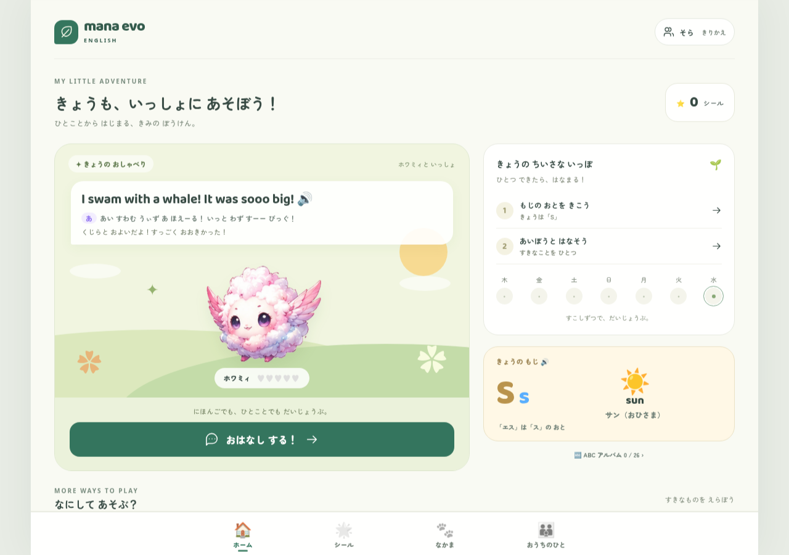
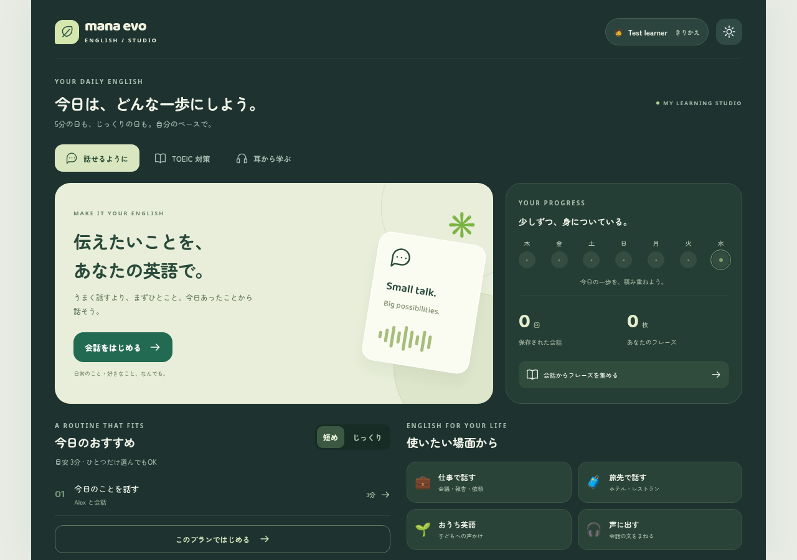
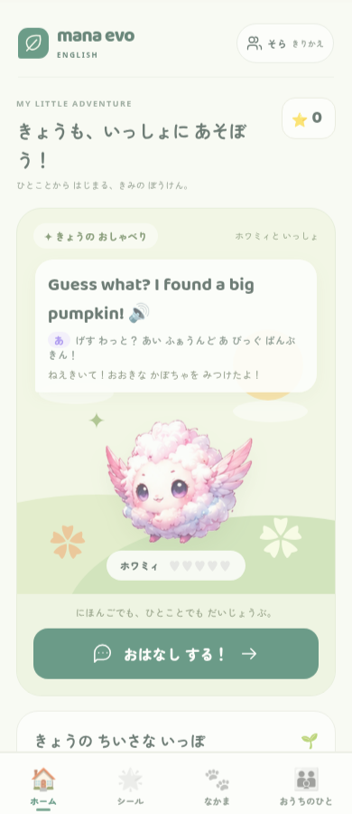
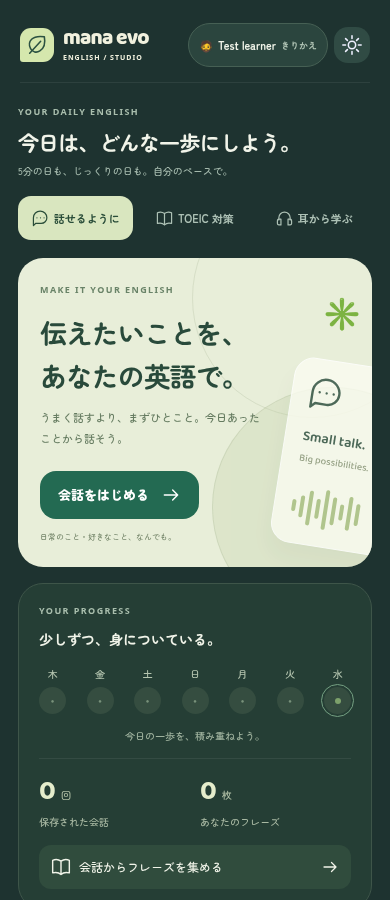

# 体験刷新の検証（2026-10-21）

ストーリー：子供/大人を選ぶ → プロフィール作成 → 今日の学習を開始 → 完了 → localStorageの記録を次回ホームへ反映。

| 境界 | 結果 | 証拠 |
|---|---|---|
| 既存ロジック | 成功 | 既存33＋追加7＝40テスト |
| Production build | 成功 | Vite 6.4.4 / 84 modules |
| 初回・子供 | 成功 | 相棒/名前→ホーム→文字→再読込後も記録維持 |
| 初回・大人のみ | 成功 | 子供profile=nullのまま登録→PIN作成→設定のログイン入力へ到達 |
| 再入場 | 成功 | 再読込→PIN必須、学習目的を保存 |
| 短めの復習 | 成功 | 12枚のdue中、表示した6枚のみ→終了→当日の学習記録 |
| TOEIC | 成功 | mockの10問を解答→解説→まとめ→10件の保存 |
| 会話 | 成功 | mock文字入力→相手の応答→終了→1件の子供セッション保存 |
| レスポンシブ | 成功 | 幅320/390/768/1280、入口・両ホームで横overflowなし。画像を目視確認 |
| 音声AI・認証の外部境界 | 未検証 | 実アカウント・マイク実機未提供。mockから本番接続の成功は推論しない |
| iOS / Safari / PWA更新 | 未検証 | Chromium desktopでのmobile viewport確認。実端末確認は#10/#11 |

コマンド：

```sh
npm ci
npm test
npm run build
npx playwright install chromium
npm run test:e2e
# この作業環境では既存Chromiumを利用：
PLAYWRIGHT_CHROMIUM_EXECUTABLE_PATH=/usr/bin/chromium npm run test:e2e -- --workers=2
```

最終E2Eは **9 passed (27.3s)**。テストは英語音声AIを呼ばない。CIにもChromiumの同じE2Eを追加。

## 実装した修正

- 初回の子供登録強制を解消、大人のログイン設定を直接提供。
- 未実装のstory/worldを主導線から外す。教材制作はIssueへ。
- planのステップ単独選択で枚数・時間を保持。
- 子供の文字学習日、大人の復習だけの日を履歴へ追加。初回の数字を架空データで埋めない。
- 子供の保存失敗を通知。TOEIC目標値の範囲/5点刻みを検証。
- TOEICの未校正換算・ASR単語一致率を正しく説明。スコアの目標達成を宣言しない。
- 新規画面のラベル、focus、選択状態、reduced motion、toast読み上げを整備。

## 画面

| 子供・PC | 大人・PC |
|---|---|
|  |  |

| 子供・390px | 大人・390px |
|---|---|
|  |  |

教材の学習効果・TOEIC得点向上は未評価。全7Part対応・本番運用強化・会話画面の分割は未完で、Issueに明示している。
